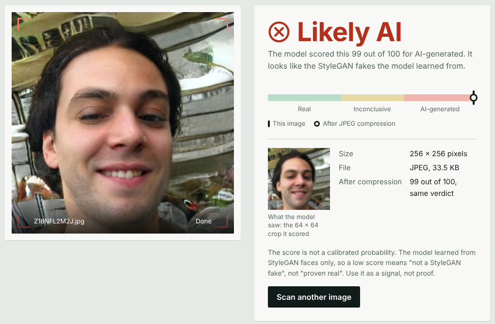
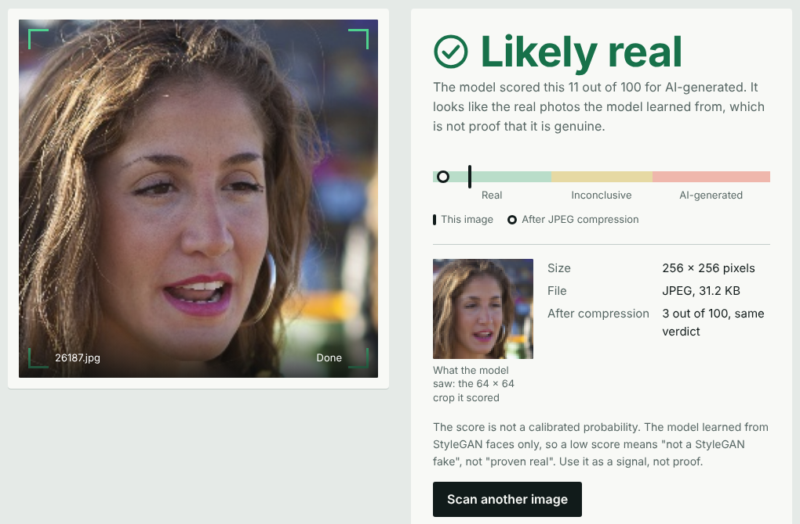

# FGAN: Detecting GAN-Generated Faces

FGAN is a small PyTorch project that decides whether a 64×64 face image is a **real photograph** or an **AI-generated (StyleGAN-style) face**.

It trains a DCGAN on real faces so that its discriminator learns what real face structure looks like, then fine-tunes that same discriminator as a real/fake detector. A local web app wraps the model and shows its own accuracy and limits.

> **Status:** university micro project (Foundation of Generative Adversarial Networks, 23AI2012). Results come from one run with one seed on a validation subset. See [Limitations](#limitations) before relying on it.




## How it works

1. **Stage 1, adversarial training.** A DCGAN generator and discriminator are trained against each other for 5 epochs on 10,000 real faces.
2. **Stage 2, fine-tuning.** The discriminator is trained as a binary classifier (fake = 0, real = 1) for 15 epochs on 10,000 labelled images. Half of the images are randomly JPEG-compressed (quality 30 to 95).
3. **Stage 3, evaluation.** The detector is tested on 2,000 validation images, clean and re-saved as JPEG quality 30.
4. **Web app.** FastAPI serves a page that returns a verdict, an AI score, the score after JPEG compression, the 64×64 crop the model saw, and an optional "no face found" check (OpenCV Haar cascade).

**Model**
- Generator: 100 → 512 → 256 → 128 → 64 → 3 channels, transposed convolutions, Tanh.
- Discriminator: four stride-2 convolutions (64, 128, 256, 512 channels), LeakyReLU 0.2, batch norm (except the first block), dropout 0.3, `Linear(8192, 1)` logit.
- Loss: binary cross-entropy on logits. Optimiser: Adam (2e-4 for the GAN, 1e-4 for fine-tuning).

## Dataset

Kaggle ["140k Real and Fake Faces"](https://www.kaggle.com/datasets/xhlulu/140k-real-and-fake-faces) (256×256 JPEGs, resized to 64×64). It is **not** included in this repository. Download and extract it so the layout is:

```
data/real_vs_fake/real-vs-fake/
    train/{real,fake}/   (50,000 each)
    valid/{real,fake}/   (10,000 each)
    test/{real,fake}/    (10,000 each)
```

Subsets used (fixed seed 0): 10,000 training images for the detector, 10,000 real images for the GAN, 2,000 validation images for results. The test split was not used for training or tuning. `outputs/training_manifest.csv` lists which image was used for what.

## Results

Validation subset: 2,000 images (1,007 fake, 993 real), final epoch. Precision and recall are for the fake class.

| Images | Accuracy | Precision | Recall |
|---|---|---|---|
| Clean | 0.875 | 0.849 | 0.914 |
| JPEG quality 30 | 0.868 | 0.847 | 0.899 |

Confusion matrix (clean): 920 fakes caught, 87 missed; 163 real faces wrongly flagged, 830 correct.

| Fine-tuning epochs | Accuracy | Precision | Recall |
|---|---|---|---|
| 5 | 0.781 | 0.899 | 0.637 |
| 15 | 0.875 | 0.849 | 0.914 |

The number of epochs was chosen while looking at these validation images, so the numbers may be slightly optimistic. The held-out test split (20,000 images) can be evaluated with `python evaluate_test.py`.

## Setup

Requires Python 3.10+ (developed on 3.12). A GPU is optional; training takes about 8 minutes on an RTX 3050 Laptop GPU.

```bash
git clone https://github.com/<your-username>/<your-repo>.git
cd <your-repo>

python -m venv .venv
# Windows:   .venv\Scripts\activate
# Linux/Mac: source .venv/bin/activate

# PyTorch: pick the command for your machine at https://pytorch.org/get-started/locally/
# Example (Windows/Linux, CUDA 12.1):
pip install torch torchvision --index-url https://download.pytorch.org/whl/cu121
# Example (CPU only):
# pip install torch torchvision

pip install -r requirements.txt
```

## Usage

```bash
# 1. Quick pipeline test on a tiny noise dataset (results are meaningless)
python make_fake_dataset.py
python fgan_tonight.py data/dummy --smoke

# 2. Full training on the real dataset (writes outputs/detector.pt)
python fgan_tonight.py data/real_vs_fake/real-vs-fake

# 3. Sanity check on the trained model
python sanity_check.py

# 4. One-time evaluation on the held-out test split
python evaluate_test.py

# 5. Web app
python app.py        # then open http://127.0.0.1:8000
```

The trained weights file `outputs/detector.pt` is needed by the web app. If it is missing, either run step 2 or download it from the repository's Releases page and put it in `outputs/`.

## Project structure

| File | Purpose |
|---|---|
| `fgan_tonight.py` | Full pipeline: DCGAN, detector fine-tuning, evaluation |
| `make_fake_dataset.py` | Tiny noise dataset for testing the pipeline |
| `sanity_check.py` | Predictions on 3 real and 3 fake images, label-direction and overlap checks |
| `evaluate_test.py` | One-time evaluation on the held-out test split |
| `app.py`, `static/index.html` | Local web app |
| `outputs/` | `gan_samples.png`, `results.md`, `log.txt`, `training_manifest.csv` |
| `unseen_images/` | 50 real and 50 fake test-split images the model never trained on |

## Limitations

- **False alarms:** it flags about 16% of real validation faces (163 of 993) as fake. It must not be the only basis for a decision.
- **Overfitting:** training loss falls close to zero while validation accuracy stays near 0.87.
- **One family of fakes:** trained on StyleGAN-style faces only. Other generators, including diffusion models, are untested. In informal tests, 2 of 8 StyleGAN-like images from the web were flagged (not a systematic measurement).
- **No concept of a face:** a blank screen, white page or noise scored as "real". "Real" only means "not recognised as a StyleGAN fake". The optional face check helps, but it found a face in only 26 of 28 real and 26 of 28 fake sample images, so it can wrongly report "no face".
- **Compression only:** robustness was tested for JPEG quality 30, not for resizing, screenshots or filters.
- **Small scale:** 64×64 images, 10,000 training images, one run, one seed.
- **Untested idea:** no comparison was run against training without the GAN stage, so the benefit of the pre-training is not established.

## References

1. I. Goodfellow et al., "Generative Adversarial Nets," NeurIPS, 2014.
2. A. Radford, L. Metz, S. Chintala, "Unsupervised Representation Learning with Deep Convolutional Generative Adversarial Networks," arXiv:1511.06434, 2015.
3. T. Karras, S. Laine, T. Aila, "A Style-Based Generator Architecture for Generative Adversarial Networks," CVPR, 2019.
4. S.-Y. Wang et al., "CNN-generated images are surprisingly easy to spot... for now," CVPR, 2020.
5. J. Frank et al., "Leveraging Frequency Analysis for Deep Fake Image Recognition," ICML, 2020.
6. R. Corvi et al., "On the detection of synthetic images generated by diffusion models," ICASSP, 2023.

## Authors

- Sameer Sunu Daniel 
- Suraj Nair 

Faculty in charge: Dr. D. Darling Jemima, Division of Artificial Intelligence and Machine Learning, Karunya Institute of Technology and Sciences.

## License

Add a license before making the repository public (for example MIT), and note that the dataset has its own terms on Kaggle.
